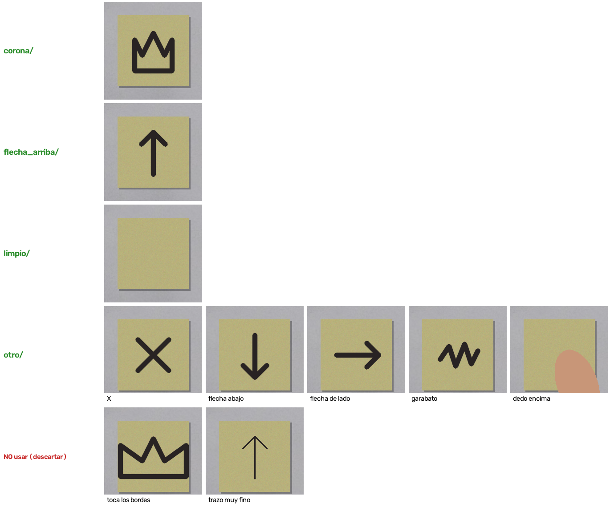

# Cómo agregar imágenes y reentrenar el modelo

El modelo mejora con **diseños distintos**, no con más fotos del mismo post-it. Cuando
agregamos 7 coronas nuevas, la exactitud en prueba subió de 74 % a 80 %, y las coronas
reconocidas pasaron de 28/44 a 41/44.



## 1. Dibujar los post-its

- **Plumón grueso**, dibujo centrado y **sin tocar los bordes** del post-it (si los toca, el detector lo pierde).
- Varía el diseño:
  - Coronas de 3 y de 5 puntas, rellenas, con joyas, altas o bajas.
  - Flechas finas, gruesas, dentro de un círculo, curvas.
- Si pueden, que dibujen distintas personas del grupo.
- Las clases son:

| Carpeta | Qué va |
|---|---|
| `corona` | cualquier corona |
| `flecha_arriba` | flechas que apuntan hacia arriba |
| `limpio` | post-its sin dibujo |
| `otro` | todo lo demás: X, flechas abajo o de lado, letras, palabras, caras, garabatos |

`otro` es muy importante: le enseña al modelo qué **no** es una corona ni una flecha. Hoy el
modelo confunde letras en zigzag (como "SÍ") con coronas, así que sirven post-its con
letras y palabras.

## 2. Capturar con el juego (tecla S)

1. Pega los post-its en la pizarra **separados** entre sí. Para ordenar más fácil, mejor **una clase por sesión**.
2. Corre `python proyecto_v3.py` y espera a que aparezcan como rectángulos amarillos con su letra.
3. Presiona **S**, espera unos 15 s y vuelve a presionar **S**.
4. Si puedes, repite con otra luz o a otra distancia.

Los recortes quedan en `dataset/sin_clasificar/` con nombres `<sesion>_p<id>_<n>.png`:
- **`<sesion>`:** la fecha y hora en que se presionó S.
- **`p<id>`:** el post-it. Todos los archivos con el mismo `p<id>` son del mismo post-it.

> Usa siempre la tecla **S**, no fotos del celular. El modelo tiene que aprender
> exactamente lo que ve el juego: el recorte del post-it, desde la webcam.

## 3. Ordenar

Mueve cada grupo de `dataset/sin_clasificar/` a su carpeta:
- **Entrenamiento:** `dataset/corona/`, `dataset/flecha_arriba/`, `dataset/limpio/` u `dataset/otro/`.
- **Prueba:** si son post-its **nuevos que el modelo nunca vio**, puedes mandar algunos a `dataset_prueba/<clase>/`. No muevas a prueba un post-it que ya está en entrenamiento.

Descarta los recortes borrosos o con mucha pared.

Para revisar que todo esté bien:

```bash
python -c "import entrenar_simbolos as E; it=E.listar('dataset'); print(E.revisar(it)); print('repetidos con prueba:', E.grupos_repetidos(it, E.listar('dataset_prueba')))"
```

Debe mostrar `([], [])` (ni errores ni avisos) y `repetidos con prueba: set()`.

## 4a. Entrenar con las carpetas locales

```bash
python entrenar_simbolos.py
```

## 4b. O compartir con el grupo por Roboflow

Proyecto de Roboflow: tipo **Classification, Single-Label**.

1. Arma una carpeta solo con lo nuevo, con una subcarpeta por clase. Por ejemplo, `nuevas/corona/*.png` y `nuevas/otro/*.png`.
2. En **Upload Data**, usa **Select Folder** y elige esa carpeta. Roboflow toma cada subcarpeta como la clase. Revisa que no queden como "Unlabeled".
3. Asigna así:
   - **Entrenamiento:** **Add all images to Training Set** (100 % Train).
   - **Prueba** (post-its nuevos, en un lote aparte): **Add all images to Testing Set** (100 % Test).
   - **Nunca** dejes que Roboflow reparta el entrenamiento con un % de Test: mezclaría post-its de entrenamiento con la prueba.
4. En **Versions**, crea una versión nueva:
   - Preprocessing: solo **Auto-Orient**. Quita el Resize o déjalo en 128×128.
   - Augmentation: **ninguno**. El volteo vertical o las rotaciones de 90° convierten la flecha arriba en otro símbolo.
5. **Download Dataset** → formato **Folder Structure** → descomprime el zip en `roboflow_export/`, reemplazando lo anterior.
6. Entrena:

   ```bash
   python entrenar_simbolos.py --roboflow roboflow_export
   ```

   El script junta Train y Valid de Roboflow y los vuelve a dividir **por post-it**, para que no haya trampa entre train y val, y usa el Test de Roboflow como prueba.

## 5. Revisar el resultado

Al final, el script imprime:
- **"Exactitud en test (top-1)":** compárala con la anterior (79,9 %).
- **La ruta de la matriz de confusión** (`confusion_matrix.png`): muestra qué clase se confunde con cuál.

Si la exactitud mejora, el modelo nuevo ya quedó copiado en `modelos/simbolos.pt` y el
juego lo usa la próxima vez que se abra. Si empeora, el anterior sigue en la carpeta de
resultados (`~/yolo_runs_proyecto/simbolos*/weights/best.pt`) y se puede volver a copiar
a `modelos/simbolos.pt`.

> El entrenamiento corre fuera de OneDrive, en tu carpeta de usuario
> (`~/yolo_runs_proyecto`), porque OneDrive bloquea los archivos mientras se guardan.
